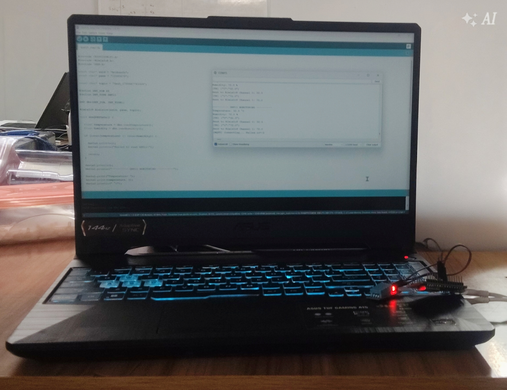
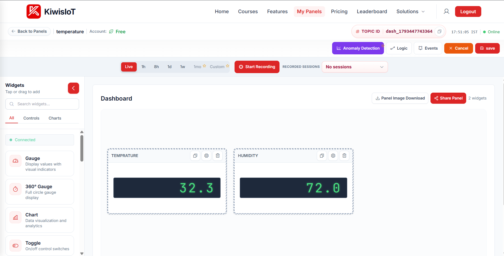
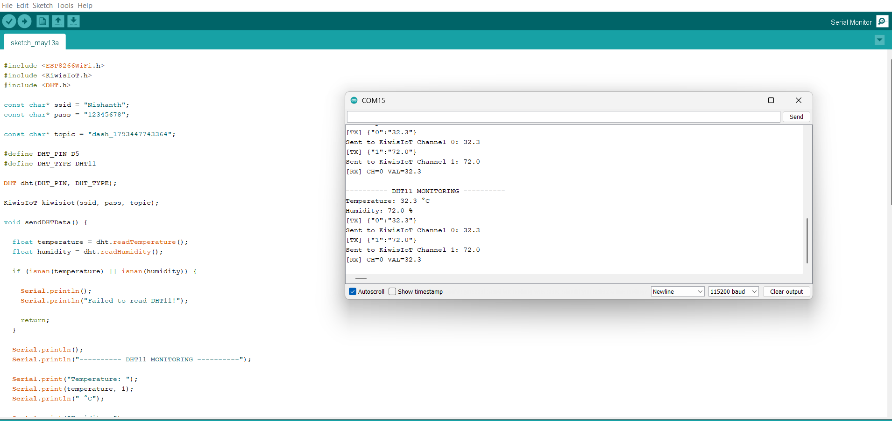

# IoT Based Environmental Monitoring System with KiwisIoT

## Project Highlights

- Reads temperature and humidity every 2 seconds with a DHT11 sensor
- Sends both values over Wi-Fi to the KiwisIoT cloud dashboard
- Shows live readings on digital display widgets, with no server or database to maintain
- Prints every reading to the Serial Monitor for debugging
- Runs on a low-cost ESP8266 board

## Project Overview

This project turns an ESP8266 NodeMCU and a DHT11 sensor into a remote environmental monitor. The DHT11 measures the air temperature and relative humidity of the room. The ESP8266 reads both values, connects to your Wi-Fi network, and forwards them to a dashboard on KiwisIoT, where you can watch them update in real time from any browser or phone.

The firmware sends temperature to **Channel 0** and humidity to **Channel 1** of your dashboard topic. Each channel maps to a widget on the dashboard. In the photos, the dashboard shows the temperature at 32.3 °C and the humidity at 72.0 %, matching the values in the Serial Monitor.

## Why This Project?

Temperature and humidity affect comfort, equipment, food storage, plant growth, and electronics. Checking them by hand is inconvenient and gives no history. This project makes monitoring automatic and remote. It also teaches several practical skills: reading a digital sensor, connecting microcontrollers to Wi-Fi, sending data to the cloud, and building a live dashboard. It is a good base for larger IoT projects such as smart rooms, server-room monitors, greenhouses, or cold-storage alarms.

## Components Required

| Component | Quantity | Notes |
|---|---|---|
| ESP8266 NodeMCU (ESP-12E) | 1 | The board in the photos is labeled KiwisIoT MCU, which is also ESP8266-based |
| DHT11 temperature and humidity sensor | 1 | Module with 3 pins (VCC, DATA, GND) |
| Jumper wires (female-to-female or male-to-female) | 3 | Connect the sensor to the board |
| Micro-USB cable | 1 | Power and programming |
| Computer with Arduino IDE | 1 | For writing and uploading code |
| 2.4 GHz Wi-Fi network | 1 | The ESP8266 does not support 5 GHz |

## Software Requirements

- **Arduino IDE** 1.8.x or 2.x
- **ESP8266 board package** (installed through Boards Manager)
- **DHT sensor library** by Adafruit (provides `DHT.h`)
- **KiwisIoT library** (provides `KiwisIoT.h`), installed according to the KiwisIoT documentation
- **KiwisIoT account** with a created panel and its Topic ID
- **USB driver** for the board's serial chip (CP2102 or CH340, depending on your board)

## Technologies Used

- **ESP8266 Wi-Fi microcontroller**: runs the firmware and connects to the internet
- **DHT11 sensor**: digital temperature and humidity measurement
- **Arduino C++**: firmware language
- **KiwisIoT**: cloud IoT platform with dashboards, widgets, recording, and anomaly detection
- **Serial communication at 115200 baud**: debugging output

## Circuit Connection

Connect the DHT11 to the NodeMCU as follows:

| DHT11 Pin | NodeMCU Pin | Purpose |
|---|---|---|
| VCC (+) | 3V3 | Power supply |
| GND (−) | GND | Ground |
| DATA (S or OUT) | D5 (GPIO14) | Data signal |

Power the sensor from 3V3 unless your module's documentation says it needs 5V. Most DHT11 modules include a pull-up resistor, so no extra resistor is needed. If your module has no pull-up, add a 10 kΩ resistor between DATA and VCC.

Connect the board to your computer with the micro-USB cable. The red LED on the DHT11 module lights up when it has power.

### Hardware Setup



## How the DHT11 Sensor Works

The DHT11 has two sensing elements inside its plastic housing:

- A **capacitive humidity sensor** whose capacitance changes as it absorbs moisture from the air.
- An **NTC thermistor** whose resistance changes with temperature.

A small chip converts both readings into digital values and sends them over a single data wire using a timing-based protocol. The ESP8266 reads this data with the DHT library, which handles the timing so you only need to call `readTemperature()` and `readHumidity()`.

Typical DHT11 specifications:

- Temperature range: 0 to 50 °C, accuracy about ±2 °C
- Humidity range: 20 to 90 % RH, accuracy about ±5 %
- Sampling rate: at most one reading every 1 to 2 seconds

The 2-second interval in the code respects this limit. Reading faster than the sensor allows returns invalid values, which is why the code checks for `NaN` (not a number) before sending.

## Temperature and Humidity Data

Each cycle the firmware:

1. Reads temperature in °C and humidity in %.
2. Checks that both readings are valid. If not, it prints an error and skips the cycle.
3. Prints the values to the Serial Monitor.
4. Converts each value to a string with one decimal place.
5. Sends temperature to Channel 0 and humidity to Channel 1.

With the sample readings in the photos, the Serial Monitor shows:

```
---------- DHT11 MONITORING ----------
Temperature: 32.3 °C
Humidity: 72.0 %
Sent to KiwisIoT Channel 0: 32.3
Sent to KiwisIoT Channel 1: 72.0
```

## KiwisIoT Dashboard

To build the dashboard:

1. Log in to KiwisIoT and open **My Panels**, then create a new panel named something like "temperature".
2. Copy the **Topic ID** shown at the top of the panel (it looks like `dash_1793447743364`). This goes into your code.
3. Drag two **Gauge** or digital display widgets onto the canvas, one labeled Temperature and one labeled Humidity.
4. Bind the first widget to Channel 0 and the second to Channel 1.
5. Click **Save**. The status indicator should show **Online** once the board connects.

The dashboard also offers useful extras:

- **Charts** for historical trends
- **Start Recording** to save sessions for later review
- **Anomaly Detection** to flag unusual readings
- **Events and Logic** to trigger actions when a value crosses a threshold, such as an alert above 35 °C
- **Share Panel** to give others view access

### Live Dashboard



## Arduino Code

### Configure Wi-Fi and KiwisIoT

Before uploading, edit these three lines in the sketch:

```cpp
const char* ssid  = "YOUR_WIFI_NAME";          // Your 2.4 GHz Wi-Fi name
const char* pass  = "YOUR_WIFI_PASSWORD";      // Your Wi-Fi password
const char* topic = "YOUR_DASHBOARD_TOPIC_ID"; // Topic ID from your KiwisIoT panel
```

Do not post your real Wi-Fi password or Topic ID publicly, since anyone with them can view or affect your panel. Keep the real values in a private copy of the sketch.

### Complete Arduino Code

The full sketch is in [`src/dht11_kiwisiot.ino`](src/dht11_kiwisiot.ino).

```cpp
#include <ESP8266WiFi.h>
#include <KiwisIoT.h>
#include <DHT.h>

const char* ssid = "YOUR_WIFI_NAME";
const char* pass = "YOUR_WIFI_PASSWORD";

const char* topic = "YOUR_DASHBOARD_TOPIC_ID";

#define DHT_PIN D5
#define DHT_TYPE DHT11

DHT dht(DHT_PIN, DHT_TYPE);

KiwisIoT kiwisiot(ssid, pass, topic);

void sendDHTData() {

  float temperature = dht.readTemperature();
  float humidity = dht.readHumidity();

  if (isnan(temperature) || isnan(humidity)) {

    Serial.println();
    Serial.println("Failed to read DHT11!");

    return;
  }

  Serial.println();
  Serial.println("---------- DHT11 MONITORING ----------");

  Serial.print("Temperature: ");
  Serial.print(temperature, 1);
  Serial.println(" °C");

  Serial.print("Humidity: ");
  Serial.print(humidity, 1);
  Serial.println(" %");

  String temperatureData = String(temperature, 1);

  kiwisiot.send("0", temperatureData);

  Serial.print("Sent to KiwisIoT Channel 0: ");
  Serial.println(temperatureData);

  String humidityData = String(humidity, 1);

  kiwisiot.send("1", humidityData);

  Serial.print("Sent to KiwisIoT Channel 1: ");
  Serial.println(humidityData);
}

void setup() {

  Serial.begin(115200);

  Serial.println("     DHT11 MONITORING     ");

  dht.begin();

  Serial.println("DHT11 initialized");

  Serial.println("Connecting to KiwisIoT...");

  kiwisiot.begin();

  Serial.println("KiwisIoT initialized");
  Serial.println("Starting temperature and humidity monitoring...");
}

void loop() {

  kiwisiot.run();

  static unsigned long lastSend = 0;

  if (millis() - lastSend >= 2000) {

    lastSend = millis();

    sendDHTData();
  }

  delay(100);
}
```

### How the Code Works

- `kiwisiot.run()` must be called on every loop pass to keep the connection alive and process incoming data.
- The `millis()` check sends data every 2 seconds without blocking the loop, so the connection keeps running between readings.
- The `isnan()` check prevents bad readings from reaching the dashboard.

## Upload the Program

1. In the Arduino IDE, go to **File → Preferences** and add the ESP8266 board manager URL if it is not already there. Then open **Tools → Board → Boards Manager**, search for "esp8266", and install it.
2. Install the **DHT sensor library** by Adafruit from the Library Manager. Install the KiwisIoT library as described in its documentation.
3. Select the board under **Tools → Board → ESP8266 Boards → NodeMCU 1.0 (ESP-12E Module)**.
4. Select the port under **Tools → Port** (for example COM15 on Windows).
5. Set **Upload Speed** to 115200.
6. Paste the code, fill in your Wi-Fi name, password, and Topic ID, and click **Upload** (the right-arrow button).
7. Open **Tools → Serial Monitor** and set the baud rate to **115200**.

Expected output after a successful connection:

```
DHT11 MONITORING
DHT11 initialized
Connecting to KiwisIoT...
KiwisIoT initialized
Starting temperature and humidity monitoring...
```

Readings should begin appearing every 2 seconds, and the dashboard widgets should update.

### Serial Monitor Output

The Arduino IDE Serial Monitor shows the readings being sent to KiwisIoT channels 0 and 1:



### Troubleshooting

- **Serial shows `Failed to read DHT11!`**: Check the wiring, confirm DATA is on D5, and make sure the sensor has power. Also confirm `DHT_TYPE` is `DHT11`, not `DHT22`.
- **Connection failure in the log (for example `Failed rc=-2`)**: The board could not reach the server. Check that your Wi-Fi is 2.4 GHz, the password is correct, and the internet is working. Also verify the Topic ID.
- **Dashboard shows no values**: Confirm the widgets are bound to Channel 0 and Channel 1, and that the panel status shows Online.
- **Upload fails**: Hold the FLASH button while uploading on boards that need it, and check the COM port and USB driver.

## Why Use KiwisIoT for DHT11 Monitoring?

- **No server required**: The ESP8266 sends data straight to the cloud, so you do not need a Raspberry Pi, a local database, or a web server.
- **Live visualization**: Gauges, digital displays, and charts update as readings arrive.
- **Remote access**: Check the room from anywhere with an internet connection.
- **History and recording**: Save sessions and review trends over time.
- **Automation**: Use Logic and Events to trigger alerts when values cross a limit.
- **Anomaly detection**: Spot unusual temperature or humidity changes without writing your own analysis code.
- **Easy sharing**: Share a panel link with classmates, teammates, or a supervisor.


